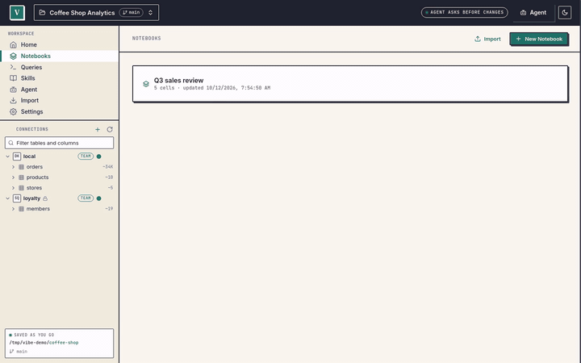
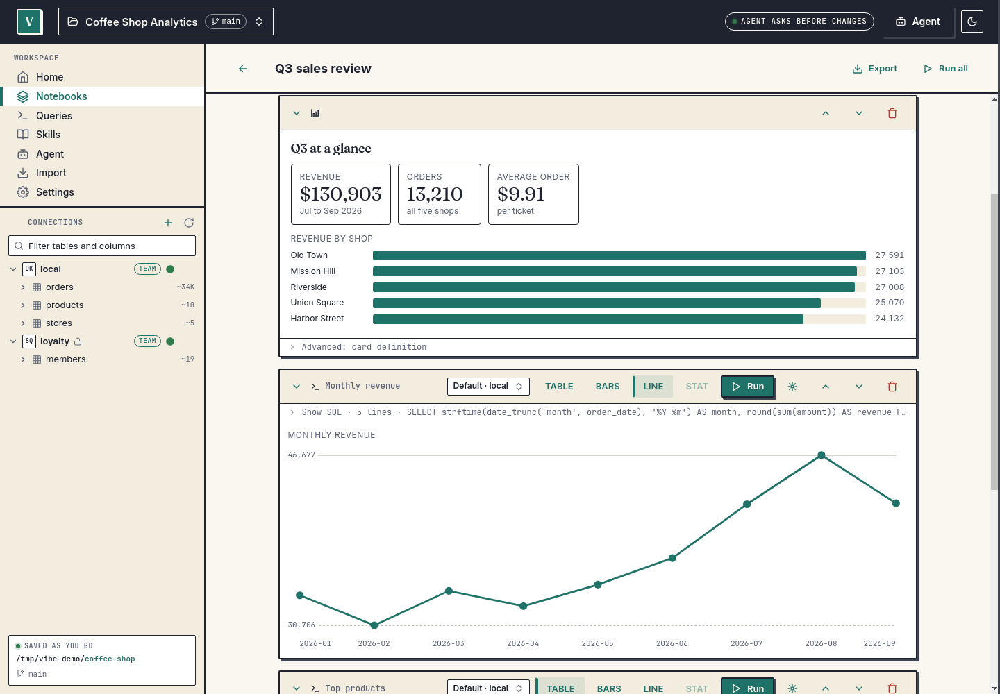

<div align="center">

# Vibe

[](https://github.com/SandwichLabs/vibe/actions/workflows/ci.yml)
[](LICENSE)

**An agentic workspace for the data you already have.**

*by [Sandwich Labs](https://github.com/SandwichLabs)*

</div>

---

Vibe is a desktop data tool in the DataGrip / DBeaver mould, with an AI agent built in. Point it at the data where it already lives (local DuckDB, CSV and Parquet files, MotherDuck, Postgres, MySQL, SQLite, S3, GCS, R2, Azure, DuckLake, Iceberg, Delta), query and join across all of it with one embedded DuckDB, and keep your notebooks, saved queries and skills as plain files in a folder you can share through git. The agent reads freely and asks before it writes; the same tools are available to Claude Code, Claude Desktop and other agents over MCP. Credentials stay in your OS keychain. Everything works without AI, and nothing is sent to Sandwich Labs.

<p align="center">
  <a href="docs/assets/hero.mp4">
    
  </a>
</p>

<details>
<summary>Still screenshot</summary>

<picture>
  <source media="(prefers-color-scheme: dark)" srcset="docs/assets/hero-notebook-dark.png">
  
</picture>

</details>

## Install

```sh
curl -fsSL https://sandwichlabs.dev/vibe/install.sh | sh
```

macOS (Apple silicon 14+, Intel 13+) and Linux (x86-64, arm64). Installs `vibe` and Vibe Studio into your home folder, no `sudo`. Options, manual download, macOS notes and uninstall: [docs/install.md](docs/install.md).

## 60-second quickstart

```sh
vibe workspace init sales-demo && cd sales-demo        # a folder with vibe.yaml, notebooks/, data/ ...
printf 'customer,amount\nAcme,120.5\nBirch,80\nAcme,45.25\n' > data/orders.csv
vibe import data/orders.csv --into orders                # load it into the workspace's DuckDB
vibe query "SELECT customer, sum(amount) AS total FROM orders GROUP BY 1 ORDER BY 2 DESC"
claude mcp add --scope user vibe-sales-demo -- "$(command -v vibe)" mcp serve --workspace "$PWD"   # Claude Code over MCP
vibe studio --gui                                        # open the desktop app on this workspace
```

Studio holds a workspace's database while it is open, and its MCP server is off until you press **Start** in Settings, Workspace, Claude and other tools. If you want Claude Code and Studio at the same time, press Start (writes then show approval cards in Studio); otherwise quit Studio before Claude Code connects.

No accounts or API keys needed. The full walkthrough, with notebooks and MCP, is the [Quickstart](docs/quickstart.md).

## What you get

- **Workspaces.** A folder you open like a vault: `vibe.yaml`, `notebooks/`, `queries/`, `skills/`, `data/`. Plain files, git-friendly, shareable with a team.
- **Connections.** Data stays where it lives, attached on first use into one DuckDB hub. Read-only by default. [Recipes](docs/connections.md) for each type.
- **Live notebooks.** SQL, Markdown and dashboard cells. Notebooks store questions, not answers: every cell re-runs when you open it.
- **Skills.** Markdown documents that teach the agent what your metrics mean and which joins are canonical, loaded on demand.
- **An agent with guardrails.** Sandbox tiers, an SQL allow-list, and an approval for every write that matters. Works with a local model, Ollama, OpenAI, Anthropic, Gemini or Cloudflare AI Gateway.
- **MCP for your own agent.** `vibe mcp serve` gives Claude Code, Claude Desktop, Cursor and others the same tools with the same limits. [Setup](docs/mcp-clients.md).
- **Credentials done properly.** OS keychain or environment variables, write-only across every boundary, never in the folder, a bundle or a log.
- **Import, export and sharing.** CSV, TSV and Excel in; CSV, Parquet, JSON and Excel out; `.vibe` bundles of notebooks, queries and skills (no data, no credentials, optional passphrase).
- **Three ways in.** The Studio desktop app, the `vibe` command line, and a terminal UI (`vibe studio`).

## Supported platforms

| Platform | Support |
|---|---|
| Linux x86-64 / arm64 | glibc 2.35+ (Ubuntu 22.04+, Debian 12+, Fedora 36+). Studio needs WebKitGTK 4.1 and GTK 3. |
| macOS, Apple silicon | macOS 14 or later |
| macOS, Intel | macOS 13 or later |
| Windows | Not supported yet |

## Status

Vibe is **pre-1.0**. Studio, the command line and MCP all work on workspace folders with connections and keychain credentials. Known limits for 0.1.0:

- **macOS builds are unsigned** (ad-hoc signed, not notarised). The install script avoids the Gatekeeper prompt; a browser download needs **Open Anyway**. See [docs/install.md](docs/install.md#macos-and-gatekeeper).
- No Windows build. Single-user: sharing is through shared backends and git.
- The chat agent needs a model you configure; a local model is the default. DuckDB extensions download once, when you ask for a feature that needs one.

See the [CHANGELOG](CHANGELOG.md) and [docs/direction.md](docs/direction.md) for what is next.

## A note on the name

Mistral Vibe, an unrelated coding agent, also installs a command named `vibe`. Our installer will not overwrite another program's `vibe`, and tells you how to proceed. If `vibe` starts the wrong program, see [Troubleshooting](docs/troubleshooting.md#vibe-starts-a-different-program). We are keeping the name for now and will revisit it before 1.0.

## Privacy

Vibe sends nothing to Sandwich Labs: no telemetry, no analytics, no update checks. Network traffic goes only to the data sources you connect, to the LLM provider you configure (which sees the prompts, schemas and query results the agent uses), and to `extensions.duckdb.org` when you ask for a feature that needs a DuckDB extension (Install, `--install`, or an Excel import or export). Details: [docs/privacy.md](docs/privacy.md).

## Documentation

| | |
|---|---|
| [Install](docs/install.md) | The installer, platforms, macOS, upgrade and uninstall |
| [Quickstart](docs/quickstart.md) | Install to a query, a notebook and Claude Code |
| [Connection recipes](docs/connections.md) | MotherDuck, Postgres, S3 and the rest |
| [Use from Claude and other MCP clients](docs/mcp-clients.md) | Setup, sandbox tiers and approvals |
| [Troubleshooting](docs/troubleshooting.md) | Common problems and how to report a bug |
| [Privacy](docs/privacy.md) | What leaves your machine |
| [Architecture](docs/architecture.md) | How the pieces fit |
| [Reference](docs/reference/README.md) | The shipped surface in detail |
| [Direction](docs/direction.md) | The north star and what changed from the plan |
| [All docs](docs/README.md) | The full index |

## Contributing, security and licence

- Build from source and contribute: [CONTRIBUTING.md](CONTRIBUTING.md) (DCO sign-off, no CLA). Be kind: [Code of Conduct](CODE_OF_CONDUCT.md).
- Report a vulnerability privately through GitHub: [SECURITY.md](SECURITY.md).
- Licensed under the [Apache License 2.0](LICENSE); see [NOTICE](NOTICE).
