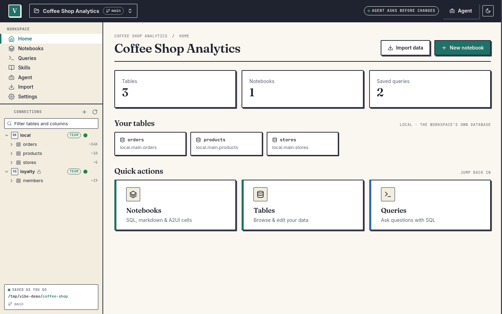
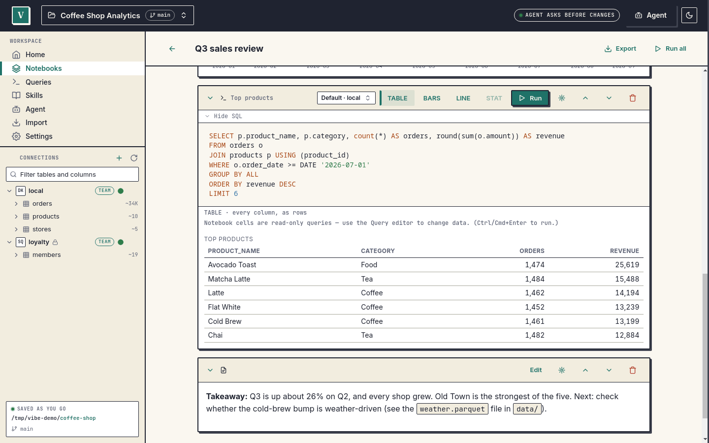

# Quickstart

From nothing to a query, a notebook and Claude Code working on your data. It needs **no accounts and no API key**: everything runs on your machine with a small CSV file you create below. About ten minutes.

## 1. Install

```sh
curl -fsSL https://sandwichlabs.dev/vibe/install.sh | sh
vibe --version
```

Other platforms, options and what the installer does: [Install](install.md).

## 2. Create a workspace

A workspace is a folder. Vibe keeps your notebooks, saved queries and skills in it as plain files, and your data stays wherever it already is.

```sh
vibe workspace init sales-demo
cd sales-demo
```

This creates `vibe.yaml`, `notebooks/`, `queries/`, `skills/` and `data/`, and one connection called `local` (a DuckDB file at `data/local.duckdb`). Add `--git` to also run `git init`. Details: [workspaces reference](reference/workspaces.md).

## 3. Add some data and query it

Make a small CSV:

```sh
cat > data/orders.csv <<'EOF'
order_id,customer,region,amount,ordered_on
1,Acme,West,120.50,2026-01-04
2,Birch,East,80.00,2026-01-09
3,Acme,West,45.25,2026-02-11
4,Cobalt,North,300.00,2026-02-14
5,Birch,East,150.75,2026-03-02
EOF
```

Query the file where it sits (DuckDB reads CSV and Parquet directly):

```sh
vibe query "SELECT region, count(*) AS orders, sum(amount) AS revenue
            FROM read_csv('data/orders.csv') GROUP BY region ORDER BY revenue DESC"
```

```
region  orders  revenue
------  ------  -------
North   1       300
East    2       230.75
West    2       165.75
(3 rows)
```

Or load it into the workspace's own database as a table and query that:

```sh
vibe import data/orders.csv --into orders
vibe query "SELECT customer, sum(amount) AS total FROM orders GROUP BY 1 ORDER BY 2 DESC"
```

Other handy commands: `vibe workspace info` (connections, counts, who owns the database), `vibe export orders -o data/orders.parquet`, `--format csv|json` on `vibe query`. More in the [workspaces reference](reference/workspaces.md#command-line).

> Run these before you open Studio. One process owns a workspace's database at a time; if Studio has it open, `vibe query` tells you so and stops.

## 4. Open Studio

```sh
vibe studio --gui
```

Run from inside the workspace, this opens the desktop app on it. You can also start **Vibe Studio** from your application menu or `~/Applications` and use **Open folder...**. (`vibe studio` without `--gui` is a terminal UI with a SQL prompt, a table browser and a notebook list.)



### Run a query

Choose **Queries** in the left navigation, type

```sql
SELECT region, sum(amount) AS revenue FROM orders GROUP BY region ORDER BY revenue DESC
```

and press **Run** (Ctrl+Enter, Cmd+Enter on a Mac). The connections rail on the left lists your tables.

### Make a notebook

1. Choose **Notebooks**, then **New notebook**, give it a title and press **Create**.
2. Use **SQL** to add a SQL cell, paste a query and press its **Run** button.
3. Add a **Markdown** cell for notes. **Run all** re-runs everything.

A notebook stores your questions, not the answers: every cell runs again when you open it, so the numbers are always current. See [notebooks](reference/notebooks.md).



## 5. Connect Claude Code (MCP)

`vibe mcp serve` exposes the workspace's tools to any MCP client, with the same limits as Studio's own agent. For Claude Code, from the workspace folder:

```sh
claude mcp add --scope user vibe-sales-demo -- "$(command -v vibe)" mcp serve --workspace "$PWD"
```

(`--scope user` makes it available in every project; without it Claude Code registers the server for the current directory only.) Studio does not start its MCP server by itself. While Studio has the workspace open, `vibe mcp serve` stops with "Studio (pid N) has this workspace open but its MCP server is off". So either quit Studio first, or open **Settings, Workspace, Claude and other tools** in Studio and press **Start**; Claude Code then works through Studio, and any change it proposes shows an approval card in the Studio window.

In Claude Code, run `/mcp` to see it connected, then ask something like *"List the tables in my Vibe workspace and tell me revenue by region."*

The default is safe: the client can read, and any write is refused until you decide otherwise. Why, and how to allow writes, is in [Use Vibe from Claude and other MCP clients](mcp-clients.md). Claude Desktop, Cursor and others: same page.

Studio can also copy the config to your clipboard for you: **Settings, Workspace, Claude and other tools** has **Copy Claude Code config** and **Copy Claude Desktop config** buttons. You paste the result yourself. Studio's Claude Code command has no `--scope`, so it registers the server for the current directory only; add `--scope user` for every project.

## 6. Optional: Studio's own agent

Studio has a chat agent too. It needs a model: a local server (the default points at `http://localhost:8080/v1`), Ollama, or an API key for OpenAI, Anthropic, Gemini or Cloudflare. Set it in **Settings, App**, or with `vibe config llm`; keys go into your keychain with `vibe config llm-key`. See [LLM configuration](reference/llm-config.md). Everything else in Vibe works without a model.

## Where next

- Connect real data: [Connection recipes](connections.md) (MotherDuck, Postgres, S3 and more).
- How it fits together: [Architecture](architecture.md).
- What stays on your machine: [Privacy](privacy.md).
- Something broke: [Troubleshooting](troubleshooting.md).
